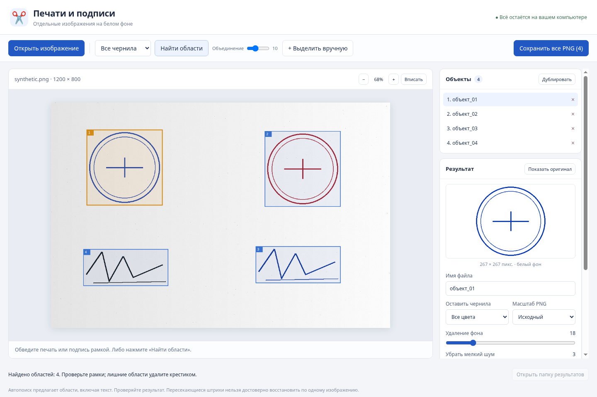

# Печати и подписи — portable для Windows

[Скачать StampExtractor-Portable-1.0.0.exe](https://github.com/Sh0MeM0/Games/blob/stamp-extractor/downloads/StampExtractor-Portable-1.0.0.exe)
— откройте страницу файла и нажмите **Download raw file**.

Программа выделяет печати и подписи на скриншотах, сканах и фотографиях,
очищает фон и сохраняет каждую область отдельным PNG на белом фоне.
Автопоиск дополнен ручными рамками, цветовыми фильтрами и кистями очистки.
Работает локально, без установки и интернета.

[Инструкция и ограничения](stamp-extractor/README.md) ·
[Исходники](stamp-extractor/) · [Проверки](stamp-extractor/VALIDATION.md)

Поддерживаются PNG, JPG, WEBP и BMP. Автопоиск не гарантирует распознавание
каждой подписи: текст может попасть в рамку, соседние объекты — объединиться.
Проверяйте результат и при необходимости выделяйте объекты вручную.
