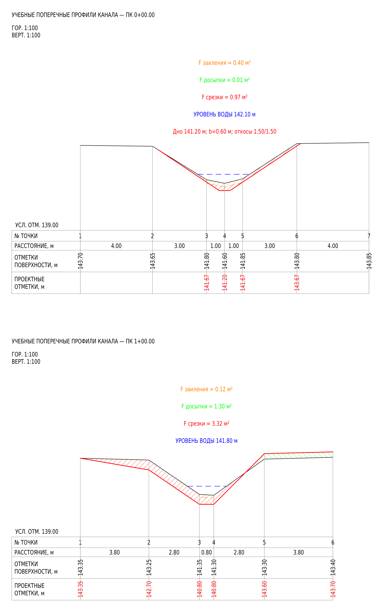

# Профиля для AutoCAD 2020–2024

Модуль для обычного AutoCAD под Windows 10/11 x64: верхнее меню **«Профиля»** в классическом интерфейсе, вкладка ленты и отдельное окно ввода и редактируемые продольные и поперечные профили каналов и прудов. AutoCAD LT и Mac не поддерживаются.

Версия **0.3.0**. В дистрибутиве отдельные сборки для каждой версии AutoCAD. Расчётное ядро проверяется автоматическими тестами; загрузка и интерфейс в настоящем AutoCAD требуют проверки на Windows. Состояние проверок перечислено в [VALIDATION.md](VALIDATION.md).

## Скачать и установить

[Скачать установщик Profiles-Setup-0.3.0.exe](https://github.com/Sh0MeM0/Games/raw/refs/heads/autocad-profiles-v0.1.0/autocad-profiles/releases/Profiles-Setup-0.3.0.exe)

**Перед обновлением с 0.1.x:** если в старом окне остались введённые данные, сохраните их кнопкой «Сохранить…» в JSON. Версия 0.1.x не сохраняла таблицы внутри DWG. После обновления импортируйте этот JSON.

1. Закройте AutoCAD, скачайте EXE и запустите установку. Требуются права администратора и .NET Framework 4.7.2 или новее.
2. Установщик помещает модуль в `C:\Program Files\Autodesk\ApplicationPlugins\Sh0MeM0.Profiles.bundle`.
3. Запустите AutoCAD. В классическом интерфейсе раздел **«Профиля»** добавляется в верхнюю строку меню, рядом с другими меню, как у MDSTools на присланном примере. При включённой ленте доступна и вкладка **«Профиля»**.
4. Выберите «Продольный профиль» или «Поперечные профили». Команды также доступны напрямую: `PROFILI`, `PROFILI_LONG`, `PROFILI_CROSS`.

**Обновление:** закройте все окна AutoCAD и установите 0.3.0 поверх предыдущей версии. При повторном запуске установщика выберите «Исправить» для установки текущих файлов или «Удалить» для удаления модуля. Ваши DWG и отдельно сохранённые JSON-проекты не удаляются. Классическое меню «Профиля» загружается из `Contents/Profiles.cuix`; модуль восстанавливает его после смены рабочего пространства.

Если строка меню скрыта или раздел не появился после смены рабочего пространства, выполните `PROFILI_MENU`: команда включает строку меню и восстанавливает раздел «Профиля». Если AutoCAD сообщает «Неизвестная команда», это означает, что сам модуль не загрузился: проверьте наличие `PackageContents.xml` в указанной папке установки и сообщения при запуске (F2). Файл меню можно подключить штатной командой `MENULOAD`, выбрав `C:\Program Files\Autodesk\ApplicationPlugins\Sh0MeM0.Profiles.bundle\Contents\Profiles.cuix`; для построения также должна загрузиться DLL модуля.

Установщик не имеет подписи издателя Authenticode. Контрольные суммы находятся в [releases/SHA256SUMS.txt](releases/SHA256SUMS.txt); проверка в PowerShell: `Get-FileHash .\Profiles-Setup-0.3.0.exe -Algorithm SHA256`. Не отключайте защитные настройки AutoCAD; каталог Program Files используется для штатной загрузки модулей.

Для ручной установки доступен [архив bundle](https://github.com/Sh0MeM0/Games/raw/refs/heads/autocad-profiles-v0.1.0/autocad-profiles/releases/Profiles-Bundle-0.3.0.zip). При закрытом AutoCAD распакуйте папку `Sh0MeM0.Profiles.bundle` в `C:\Program Files\Autodesk\ApplicationPlugins`. Удаление установленной EXE версии — через «Установленные приложения» Windows. Сохранённые отдельно JSON-проекты не удаляются.

## Выбор оформления

В окне проекта выберите шаблон. Он определяет столбцы ввода, подписи и состав таблицы продольного профиля и сохраняется вместе с проектом:

| Шаблон | Основа | Оформление |
| --- | --- | --- |
| Подчистка канала | PRODPROF11 | Берега, вода, глубина подчистки, уклон, проектное и существующее дно, ширина и откосы; колонка подписей 55 мм. |
| Новый канал | PRODPROF1 | Поверхность земли, глубина торфа, уклон, проектное дно, ширина и откосы; колонка подписей 55 мм. |
| Сети НВК | PRODPROF6 | Низ/лоток трубы, проектная и натурная земля, обозначение трубы, основание, уклон/длина, расстояния и номера колодцев/точек; колонка подписей 60 мм. |

Для НВК проектная отметка земли вводится отдельно от проектного дна канала. Натурная земля показана чёрной штриховой линией, проектная земля — красной сплошной толщиной 0,40 мм, как в LISP. Невведённые данные труб остаются пустыми; номера точек можно задать вручную. Для нового канала можно ввести глубину торфа. Площади берутся из поперечников того же проекта, объёмы — из площадей соседних поперечников. Строки объёмов срезки, досыпки и удаления ила строятся всегда, даже когда расчёт ещё невозможен; в этом случае ячейки пустые. Основные восемь строк НВК также сохраняются всегда. Поперечники используют отдельное оформление по POPROF11.

## Ввод данных

Все расстояния и отметки вводятся **в метрах**, откосы — как отношение горизонтального заложения к высоте: `1.5` означает 1,5 м по горизонтали на 1 м по вертикали (обозначение **1:1,5**). Дробные числа допускают точку или запятую. Пикет `1+25.50` означает 125,50 м. Пустая ячейка не превращается в ноль. В продольной таблице пустые отметки между двумя известными значениями автоматически интерполируются по расстоянию между пикетами. За пределами известных отметок продолжение линии не вычисляется.

**Продольный профиль.** Введите возрастающие пикеты, отметки поверхности, левого и правого берегов, существующего дна и воды. Заполняйте только имеющиеся столбцы. Для проекта укажите проектное дно; ширина по дну и левый/правый откосы могут быть указаны отдельно как табличные данные. Для поверхности, берегов, существующего и проектного дна, уреза, проектной земли и лотка трубы действует линейная интерполяция: `h = h1 + (h2 − h1) × (ПК − ПК1) / (ПК2 − ПК1)`. Расчётные значения отображаются курсивом; исходные ячейки остаются пустыми, поэтому изменение опорной отметки пересчитывает промежуточные. Ввод числа в такую ячейку задаёт новую опорную отметку. Ширина дна и откосы автоматически не интерполируются. Диагональ и подписи строки «Уклон / длина» строятся между исходными проектными точками: расчётные промежуточные пикеты не дробят этот участок. Для каналов уклон показан в промилле, для лотка трубы НВК — в процентах.

**Поперечники.** Слева выберите поперечник и пикет из продольного профиля. Связанный поперечник получает название вида `ПК 1+60.00`. В горизонтальной таблице каждая колонка — точка, строки — расстояние **от предыдущей точки**, фактическая и проектная отметки. У первой точки предыдущего интервала нет. При создании из пикета автоматически появляются колонки левого берега, дна и правого берега; переносятся известные отметки, урез и параметры проекта. Поперечные расстояния задайте по съёмке: продольная таблица их не содержит. Неизвестные расстояния можно оставить пустыми и сохранить черновик; для построения они необходимы.

Добавляйте колонки слева или справа от выбранной точки и заполняйте расстояния между ними. В пустой ячейке отметки нажмите стрелку и выберите «Интерполировать»: программа использует ближайшие известные отметки с двух сторон и накопленные поперечные расстояния. За пределами известных отметок продолжение не вычисляется. После добавления или удаления точки проверьте затронутые интервалы — программа не придумывает их длины. Слева и справа понимаются стороны при взгляде по направлению течения.

Отметки и расстояния отображаются с двумя знаками после запятой; полная точность сохраняется в проекте и расчётах. Само открытие и сохранение окна не округляет исходные данные. Перенесённые отметки остаются связаны с продольником; ручная правка отдельной отметки отключает её связь.

Выберите способ задания проекта:

- **Трапеция:** проектное дно, ширина и оба откоса. Выберите колонку точки для оси проектного дна; под ней показывается опорная проектная отметка. Центр можно определить по фактическому дну или задать самостоятельно. Откосы доходят до пересечения с измеренным контуром; если съёмка слишком короткая, нужно добавить точки.
- **По проектным отметкам:** произвольные проектные отметки в нижней строке, например для пруда. Между известными проектными точками проходит линия; за крайними проектными точками продолжения нет.
- **Без проекта:** только фактический профиль и необязательные вода и очистка от ила. Ранее введённый проект сохраняется для повторного включения.

Урез воды необязателен и ограничивается затопленными участками контура. Для связанного пикета его отметка переносится из продольника.

## Площади и объёмы

Справа от таблицы задайте толщину удаления ила и при необходимости левую и правую границы очистки в поперечных координатах. Толщина снимается **вертикально вниз** от фактической поверхности. При пустых границах используется ширина проектного контура, а без проекта — весь измеренный контур. Срезка и досыпка считаются между **уже очищенной** поверхностью и проектом. Проектная геометрия остаётся заданной независимо от толщины ила; ил учитывается отдельно и повторно в срезку не включается.

На поперечнике показываются очищенная поверхность, штриховки и площади: срезка — красная, досыпка — зелёная, ил — отдельная. Площади рассчитываются в м² до применения масштабов чертежа. Пропуски съёмки или неполный проект не превращаются в нулевую площадь.

После редактирования поперечников перестройте продольный профиль. Нижние строки показывают площади в сечениях и объёмы между соседними поперечниками с известными пикетами:

```
V = (F1 + F2) / 2 × (ПК2 − ПК1)
```

Срезка, досыпка и ил считаются отдельно в м³. Промежуточный пикет продольника без поперечника не прерывает участок расчёта. Незавершённый поперечник или два поперечника на одном пикете не позволяют считать соседние интервалы; программа выводит причину. Для поперечника без пикета нельзя определить положение в расчёте объёма. Неизвестные значения остаются пустыми, настоящий рассчитанный ноль выводится как `0.00`. **Три строки объёмов всегда присутствуют**, даже без поперечников и при отключённом показе других пустых строк.

Таблицы поддерживают вставку данных из Excel через буфер обмена (столбцы разделяются табуляцией). Для поперечника копируйте горизонтальную таблицу: точки по колонкам, расстояния и отметки по строкам. Перед вставкой выберите первую целевую ячейку. Кнопка примера заполняет демонстрационные данные; «Импорт JSON» и «Экспорт JSON» работают с отдельным файлом проекта. Автозапись выбранного JSON включается отдельным флажком.

## Проекты и перестроение

В одном DWG можно хранить несколько именованных проектов. Продольная таблица и поперечники относятся к выбранному проекту. Корректно введённые числовые данные, включая незавершённый профиль, автоматически записываются в данные чертежа; полнота геометрии проверяется при предпросмотре и построении. **Сохраните сам DWG**, чтобы данные остались в файле после закрытия AutoCAD. Ошибочный текст в числовом поле нужно исправить до сохранения. JSON остаётся отдельным способом экспорта и переноса проекта; файлы прежних версий 1 и 2 читаются и при сохранении преобразуются в версию 3. Проекты, сохранённые внутри DWG модулем 0.2.0, открываются с сохранением связи с построением.

После повторного открытия DWG выберите проект, исправьте нужный пикет или отметку и нажмите «Перестроить на месте». Модуль обновляет своё предыдущее построение этого проекта и типа на прежнем месте. «Построить / переместить» задаёт новое место для результата и заменяет прежнее построение этого проекта и типа. Продольный и набор поперечных профилей хранятся отдельно. Сторонние объекты не удаляются. Построения версии 0.1.x не имеют связи с проектом: сначала создайте новое построение версии 0.3.0, прежние линии при необходимости удалите вручную.

## Масштаб и оформление

Задаются горизонтальный и вертикальный масштабы, условная нулевая отметка, высота текста и коэффициент ширины. Если нулевая отметка пуста, выбирается целое значение ниже минимальной отметки. Явно введённый ноль должен быть ниже всего профиля.

Параметр «метров в единице чертежа» задаёт размер создаваемых объектов: `1` для метрических единиц модели, `0.001` для миллиметров. Он не выводится автоматически из `INSUNITS`, поскольку в исходных чертежах эти сведения могут быть недостоверны. Формулы повторяют присланные LISP-шаблоны:

```
X = расстояние / k
Y = (отметка − условный ноль) × H / (k × V)
размер 1 мм оформления = H / (1000 × k)
```

Здесь H и V — знаменатели масштабов, k — метров в единице чертежа. Печать на бумаге должна учитывать этот коэффициент; команда не меняет настройки листа или печати. Оформление использует текущий текстовый стиль AutoCAD: выберите стиль с кириллицей, например Arial. Основной размер текста — 2,5 мм. Колонка заголовков продольных профилей каналов — 55 мм, НВК — 60 мм; поперечная — 38 мм. Необязательные пустые строки можно скрыть или оставить для ручного оформления; нижние строки объёмов остаются всегда.

Готовый профиль состоит из обычных полилиний, текстов и редактируемых штриховок на слоях `PROF_*`, без кружков на вершинах. Проектное дно — красная сплошная линия; существующее дно и левый берег — чёрные сплошные; правый берег — пурпурная штриховая; вода — синяя штриховая. Числовые отметки чёрные, проектные красные, вода синяя. Для чёрного используется стандартный цвет AutoCAD ACI 7: он белый на тёмном фоне модели и чёрный на белом фоне/при обычной печати; стили печати CTB/STB могут переопределять цвета. Над таблицей подчистки размещена легенда «Условные обозначения» с пятью образцами: проектное дно, существующее дно, левый берег, правый берег и вода. Точку вставки укажите после подтверждения окна. Вставка учитывает текущую ПСК; отмена выбора точки ничего не добавляет. Одной командой `UNDO` можно отменить построение.

Предпросмотр показывает геометрию и структуру таблицы. Окончательные метрики шрифта определяет AutoCAD. При плотных пикетах увеличьте горизонтальный масштаб изображения (уменьшите знаменатель) или разбейте профиль на части; программа сообщает о тесных колонках.

Модуль не рассчитывает гидравлику и соответствие нормам. Фактические отметки берутся только из введённых данных. Результат нужно проверить перед выпуском чертежа. Исходный DWG пользователя и сторонняя программа MDSTools в дистрибутив не входят.

## Пример результата

Ниже изображение синтетического примера, полученное из фактического плана расчётного ядра. Это не снимок окна AutoCAD. JSON и редактируемые DXF находятся в `examples` в исходниках и `Examples` в установленном bundle.



[Подчистка канала](docs/example-longitudinal.png) · [Продольник с объёмами](docs/example-longitudinal-earthworks.png) · [Новый канал](docs/example-new-channel.png) · [Сети НВК](docs/example-nvk.png)

## Сборка из исходников

Нужны .NET SDK 8.0.426, Python 3 и NSIS 3.11. SDK AutoCAD загружается из официальных пакетов NuGet `AutoCAD.NET`, `AutoCAD.NET.Core`, `AutoCAD.NET.Model`; DLL Autodesk в установщик не включаются. Команда из этой папки:

```bash
python3 build.py
```

Скрипт сначала запускает тесты, затем собирает пять вариантов модуля и создаёт EXE, ZIP и SHA-256 в `releases`. Параметры `--dotnet` и `--makensis` задают пути к инструментам. При локально распакованном NSIS укажите переменную `NSISDIR` на его каталог `share/nsis`.

Лицензия — AGPL-3.0-or-later, как у основного репозитория. Зависимости и их лицензии: [THIRD_PARTY_NOTICES.md](THIRD_PARTY_NOTICES.md).
