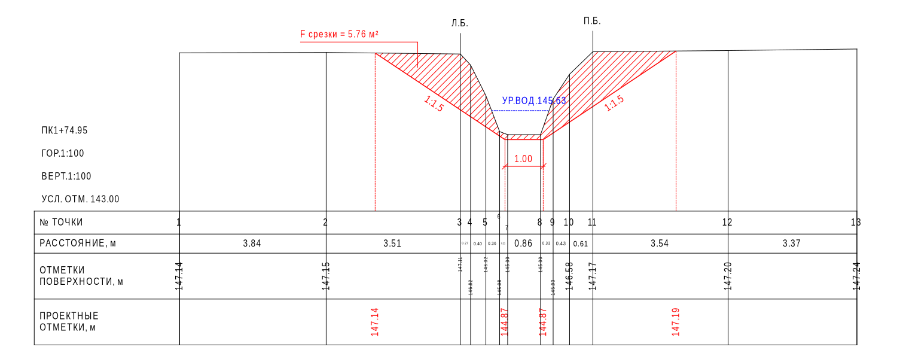
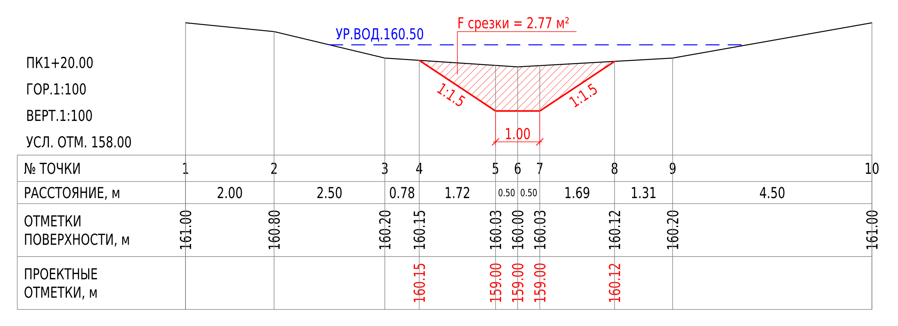

# Профиля для AutoCAD 2020–2024

Модуль для обычного AutoCAD под Windows 10/11 x64: верхнее меню **«Профиля»** в классическом интерфейсе, вкладка ленты и отдельное окно ввода и редактируемые продольные и поперечные профили каналов и прудов. AutoCAD LT и Mac не поддерживаются.

Версия **0.8.6**. В дистрибутиве отдельные сборки для каждой версии AutoCAD. Расчётное ядро проверяется автоматическими тестами; загрузка и интерфейс в настоящем AutoCAD требуют проверки на Windows. Состояние проверок перечислено в [VALIDATION.md](VALIDATION.md).

## Изменения 0.8.6

- **Удаление лишнего продольного профиля.** Выберите его вкладку и нажмите «Удалить профиль…» рядом с «Имя профиля…». После подтверждения удаляются только данные этой вкладки и её поперечники; остальные профили сохраняются. Уже построенные объекты остаются в DWG. Единственный профиль удалить нельзя: создайте другой или удалите весь проект.
- **Продолжение отметок в конце профиля.** У новых конечных пикетов пустые фактическое дно, проектное дно, проектная земля и лоток НВК экстраполируются по двум последним введённым отметкам соответствующей колонки с учётом расстояний. Например, ПК 0+00 = 100,00 и ПК 0+20 = 99,00 дают на ПК 0+50 отметку 97,50. Если известна одна отметка, продолжается её высота. Курсивные значения остаются расчётными и обновляются при изменении опор; введённое вручную число имеет приоритет. Перед первой опорой продолжения нет. Ширина, откосы, вода и съёмка берегов сохраняют прежние правила.

После обновления нажмите **«Перестроить текущий»** или **«Перестроить все»**. Формат хранения DWG/JSON не изменился. Продолжение дна является расчётным предположением: проверьте его перед выпуском чертежа.

## Ранее: изменения 0.8.5

- **Номера точек и расстояния — только для существующего профиля.** Проектные вершины и пересечения не создают дополнительных номеров, не делят измеренные интервалы и не уменьшают их подписи. Если у точки нет существующей отметки, она не участвует в этих двух строках.
- **Проектные точки дают только отметки.** Их отдельные выносы — красные пунктирные линии от проектной вершины до верха таблицы; дополнительные колонки таблицы не создаются. Совпадающий вынос существующей точки используется один раз; если проект выше существующей поверхности, над ней добавляется пунктирное продолжение. Линия самого проектного контура и размер ширины дна сохраняются.
- Над назначенными берегами добавлены **«Л.Б.» и «П.Б.» с линиями к точкам съёмки**. Для выбора берегов нажмите «Роль ▾» / «Назначить ▾» в шапке нужной колонки и выберите «Левый берег» или «Правый берег». При близких берегах подписи раздвигаются, положение точек сохраняется.

После обновления нажмите **«Перестроить текущий»** или **«Перестроить все»**. Все исправления 0.8.4, включая 13 видимых колонок и чёрную сетку, сохранены.

Контрольный пример из предпросмотра модуля:



## Ранее: изменения 0.8.4

- В таблице поперечника видны **13 колонок точек** при обычной ширине окна и закрытой панели «Ил / площади». Ввод сохраняется при изменении размера окна; дополнительные точки доступны прокруткой.
- Линии шапки, таблицы и вертикальные ординаты используют чёрный цвет на белом фоне (стандартный цвет AutoCAD ACI 7).
- В строке существующих отметок подписываются точки съёмки; в строке проектных — собственные вершины проекта. Переломы соседней линии и пересечения внутри сегментов больше не добавляют лишних отметок. В ручном проекте подписываются введённые опоры, включая привязанное проектное дно; пустые промежуточные ячейки по-прежнему интерполируются для построения линии.

После установки нажмите **«Перестроить текущий»** или **«Перестроить все»**, чтобы применить цвета и подписи к уже вставленным профилям. Геометрия линий, площади и сохранённые исходные точки не изменены.

## Ранее: изменения 0.8.3

- В таблице поперечника помещаются **12 колонок точек** при обычной ширине окна и закрытой панели «Ил / площади». Размеры подстраиваются при изменении окна, текущий ввод сохраняется. В узких колонках кнопка назначения называется «Роль ▾».
- У нового пикета, в том числе добавленного из чертежа, между известными значениями интерполируются **ширина дна и оба откоса**, а также фактическое и проектное дно. Курсив показывает расчётные значения: изменение соседних опор пересчитывает их; исходные пустые ячейки не превращаются в фиксированные числа. В версии 0.8.3 за крайними опорными пикетами интерполяции не было; продолжение конечных отметок добавлено в 0.8.6.
- Чтобы назначить импортированный **«Промер 1»** на продольный профиль, введите `0+20`, `20` или `ПК 0+20` в поле **«Имя / ПК»** и нажмите Enter либо выйдите из поля. Отметки берегов и дна переносятся на пикет; точки и измеренные расстояния сохраняются. Обычное текстовое имя остаётся названием без привязки.
- Кнопка **«Назначить на продольный…»** рядом с именем открывает выбор готового пикета; можно ввести и новый. Если измеренные отметки отличаются от имеющихся, перед заменой перечисляются изменяемые поля. Другой поперечник на том же пикете не удаляется. Выбор из списка сохраняет полную точность пикетажа.
- Размер подписей расстояний определяется местом внутри своего интервала. Тесная группа точек больше не уменьшает подписи по всей строке; короткие интервалы не раздувают текст. Обновлена встроенная справка F1.

После назначения промера перейдите в «Продольный профиль», проверьте таблицу и нажмите **«Перестроить текущий»** для обновления уже вставленного чертежа. Старые поперечники с неправильным размером подписей также перестройте. Формат DWG/JSON не изменён; все исправления 0.8.2 сохранены.

## Ранее: изменения 0.8.2

Исправления:

- Кнопки ленты «Продольный профиль» и «Поперечные профили» теперь сначала прерывают активную команду, как пункты верхнего меню (`^C^C`). Раньше нажатие во время другой команды, например ОТРЕЗОК, передавало имя команды в её запрос вместо запуска окна.
- Доступность кнопок ленты больше не зависит от того, был ли открыт чертёж в момент создания вкладки: прежний обработчик проверял это один раз и не сообщал об изменениях.
- Окно предпросмотра больше не заменяется красным крестом при ошибке отрисовки отдельного объекта; пропущенные объекты перечисляются в предупреждении.
- Контекстное меню продольной таблицы и полужирные шрифты явно освобождаются при закрытии окна; раньше они создавались при каждом открытии и не освобождались.
- Диалоги названия проекта и профиля больше не перекрывают поля при масштабе Windows 125–150 %.

Интерфейс:

- Кнопка **«Удалить проект…»**: удаляет проект из чертежа, в том числе лишние демонстрационные проекты. Ранее удалить проект из DWG было нельзя. Уже построенные линии и тексты остаются в чертеже как обычные объекты.
- Кнопка **«Справка (F1)»** с кратким порядком работы, горячими клавишами и ссылкой на папку с полным руководством. **F5** — «Проверить и показать».
- Строка «Порядок: ① проект и тип → ② данные → ③ «Проверить» (F5) → ④ «Построить»» над рабочей областью.
- Шрифт окна увеличен с 8,5 до стандартных для Windows 9 пт; ширина полей, колонок и панелей учитывает масштаб экрана Windows (125 %, 150 % и т. д.).
- Поле названия поперечника расширено; предупреждения в строке состояния отмечены знаком ⚠, а не только цветом; полям ввода заданы доступные имена для экранного диктора.

Формат хранения проектов в DWG и JSON по сравнению с 0.8.1 не изменился. Расчётное ядро (геометрия, площади, объёмы) в 0.8.2 не менялось.

## Исправление 0.8.1

Исправлена ошибка «Доступ к ликвидированному объекту невозможен. Имя объекта: ContextMenuStrip» у кнопок **«Назначить ▾»** в шапке поперечника. Меню освобождается вместе с таблицей, после завершения обработки его событий. Назначение ролей и введённые отметки сохраняются.

Исправлено размещение выносок площадей срезки, досыпки и заиления: подпись выбирает свободное место рядом с поперечником, даже если исходная точка выноски перекрывается рамкой другой надписи. Площади и исходные данные не изменяются. Уже построенный профиль обновите кнопкой «Перестроить текущий» после установки.

## Скачать и установить

[Скачать установщик Profiles-Setup-0.8.6.exe](releases/Profiles-Setup-0.8.6.exe)

**Перед обновлением с 0.1.x:** если в старом окне остались введённые данные, сохраните их кнопкой «Сохранить…» в JSON. Версия 0.1.x не сохраняла таблицы внутри DWG. После обновления импортируйте этот JSON.

1. Закройте AutoCAD, скачайте EXE и запустите установку. Требуются права администратора и .NET Framework 4.7.2 или новее.
2. Установщик помещает модуль в `C:\Program Files\Autodesk\ApplicationPlugins\Sh0MeM0.Profiles.bundle`.
3. Запустите AutoCAD. В классическом интерфейсе раздел **«Профиля»** добавляется в верхнюю строку меню, рядом с другими меню, как у MDSTools на присланном примере. При включённой ленте доступна и вкладка **«Профиля»**.
4. Выберите «Продольный профиль» или «Поперечные профили». Команды также доступны напрямую: `PROFILI`, `PROFILI_LONG`, `PROFILI_CROSS`.

**Обновление:** закройте все окна AutoCAD и установите 0.8.6 поверх предыдущей версии. При повторном запуске установщика выберите «Исправить» для установки текущих файлов или «Удалить» для удаления модуля. Ваши DWG и отдельно сохранённые JSON-проекты не удаляются. Классическое меню «Профиля» загружается из `Contents/Profiles.cuix`; модуль восстанавливает его после смены рабочего пространства.

Если строка меню скрыта или раздел не появился после смены рабочего пространства, выполните `PROFILI_MENU`: команда включает строку меню и восстанавливает раздел «Профиля». Если AutoCAD сообщает «Неизвестная команда», это означает, что сам модуль не загрузился: проверьте наличие `PackageContents.xml` в указанной папке установки и сообщения при запуске (F2). Файл меню можно подключить штатной командой `MENULOAD`, выбрав `C:\Program Files\Autodesk\ApplicationPlugins\Sh0MeM0.Profiles.bundle\Contents\Profiles.cuix`; для построения также должна загрузиться DLL модуля.

Установщик не имеет подписи издателя Authenticode. Контрольные суммы находятся в [releases/SHA256SUMS.txt](releases/SHA256SUMS.txt); проверка в PowerShell: `Get-FileHash .\Profiles-Setup-0.8.6.exe -Algorithm SHA256`. Не отключайте защитные настройки AutoCAD; каталог Program Files используется для штатной загрузки модулей.

Для ручной установки доступен [архив bundle](releases/Profiles-Bundle-0.8.6.zip). При закрытом AutoCAD распакуйте папку `Sh0MeM0.Profiles.bundle` в `C:\Program Files\Autodesk\ApplicationPlugins`. Удаление установленной EXE версии — через «Установленные приложения» Windows. Сохранённые отдельно JSON-проекты не удаляются.

## Профили внутри проекта

Над вкладками редактора находятся небольшие именованные вкладки продольных профилей. Нажмите **«+ Профиль»**, чтобы создать пустой профиль, или **«Имя профиля…»**, чтобы переименовать текущий. У каждой вкладки свои продольные данные, поперечники, шаблон и масштабы. При переходе в «Поперечные профили» виден только список текущей продольной вкладки. Данные остальных вкладок сохраняются в том же проекте DWG и JSON.

Выбор другого типа оформления — «Подчистка канала», «Новый канал» или «Сети НВК» — создаёт **новую пустую вкладку** этого типа. Прежние точки и поперечники остаются в прежней вкладке; для продолжения работы выберите её по имени. Новые вкладки не получают чужие отметки и поперечники.

Если поперечник введён вручную или взят с плана, назначьте ему пикет. Общие введённые данные поперечника создают или обновляют строку в соответствующей продольной вкладке, которая располагается по пикетажу. Ручные отметки поперечника имеют приоритет при его первом связывании; недостающие общие значения могут заполняться из продольника. Дальнейшие изменения синхронизируются в обе стороны внутри этой вкладки.

## Взять отметки из чертежа

Кнопка **«Взять из чертежа…»** доступна для продольного и поперечного ввода. Текущие правки сохраняются перед переходом к командной строке AutoCAD; после набора снова открывается редактор с таблицами.

1. Задайте единицы исходной съёмки. Для модели в метрах выберите **1 единица = 1 метр**. Масштаб печати 1:1000 сам по себе не меняет расстояния в модели. Если исходные координаты заданы миллиметрами на бумаге, выберите этот режим и масштаб; доступны также собственный коэффициент и калибровка по двум точкам с известным расстоянием. Эти параметры независимы от масштабов оформления профиля.
2. Для продольника задайте начальный пикет (по умолчанию 0+00), укажите точку начала оси и последующие точки по порядку. Пикетаж вычисляется как сумма расстояний XY между указанными точками. Между ними запрашиваются отметки выбранного шаблона: для подчистки — левый/правый берег, дно, проектное дно и урез.
3. Введите отметку числом либо выберите **«Текст»** и укажите TEXT, MTEXT или атрибут с одной отметкой. Режим **Z** читает высоту указанной точки с переводом единиц. Щелчки по текстовым подписям не изменяют расстояния. Enter пропускает отсутствующую отметку, а при запросе следующей точки завершает набор.
4. Для поперечников указывайте точки слева направо по течению и задавайте фактические/необязательные проектные отметки. Enter завершает текущий поперечник; после общего уреза можно начать следующий. Enter на запросе первой точки следующего поперечника завершает весь набор.
5. Подтвердите перенос данных. Продольные точки дополняют строки с совпадающими пикетами; пропуски не стирают прежние отметки. Поперечники добавляются отдельными промерами без пикета: назначьте его вручную или выберите из продольника. Esc отменяет текущий набор, сохраняя ранее введённый проект.

В шапке каждой колонки поперечника есть видимая кнопка меню. Через неё назначьте **левый берег, дно, правый берег или обычную точку**. Роль переносится с прежней колонки; заголовки и номера точек обновляются, отметки и расстояния сохраняются. Название колонки можно изменить через это же меню или двойным щелчком по заголовку. Проектное дно под нужной точкой можно назначить кнопкой «Дно под точкой» или двойным щелчком по другой ячейке строки «Проект, м», после чего ввести отметку в выбранной ячейке. Если при наборе с плана проектное дно пропущено, его можно добавить позже здесь, в поле «Дно» или в продольной таблице. При первом назначении центр рассчитывается по фактическому дну, а отметка появляется в таблице. Если центр расположен между измеренными точками, ячейка показывает общую отметку без смещения оси; назначение через «Дно под точкой» явно привязывает ось к выбранной точке. Ручной выбор опорной точки сохраняется при дальнейших правках.

## Выбор оформления

Выбор другого шаблона создаёт новую пустую вкладку. Шаблон определяет столбцы ввода, подписи и состав таблицы этой продольной вкладки и сохраняется вместе с ней:

| Шаблон | Основа | Оформление |
| --- | --- | --- |
| Подчистка канала | PRODPROF11 | Берега, вода, глубина подчистки, уклон, проектное и существующее дно, ширина и откосы; колонка подписей 55 мм. |
| Новый канал | PRODPROF1 | Поверхность земли, глубина торфа, уклон, проектное дно, ширина и откосы; колонка подписей 55 мм. |
| Сети НВК | PRODPROF6 | Низ/лоток трубы, проектная и натурная земля, обозначение трубы, основание, уклон/длина, расстояния и номера колодцев/точек; колонка подписей 60 мм. |

Для НВК проектная отметка земли вводится отдельно от проектного дна канала. Натурная земля показана чёрной штриховой линией, проектная земля — красной сплошной толщиной 0,40 мм, как в LISP. Невведённые данные труб остаются пустыми; номера точек можно задать вручную. Для нового канала можно ввести глубину торфа. Площади берутся только из поперечников выбранной продольной вкладки, объёмы — из площадей соседних поперечников этой вкладки. Строки объёмов срезки, досыпки и удаления ила строятся всегда, даже когда расчёт ещё невозможен; в этом случае ячейки пустые. Основные восемь строк НВК также сохраняются всегда. Поперечники используют отдельное оформление по POPROF11: высота строки «№ точки» — 6 мм, «Расстояние» — 5 мм, фактических и проектных отметок — по 12 мм. Числа расстояний стоят по центру строки и имеют высоту 2,5 мм; уменьшается только подпись отдельного тесного интервала.

## Ввод данных

Таблица выбранного шаблона строится целиком. Отсутствующие отметки оставляют пустые ячейки; строки и рамка не сокращаются. Название, масштабы и условные обозначения продольного профиля расположены ниже, в левом поле над условным горизонтом.

Все расстояния и отметки вводятся **в метрах**, откосы — как отношение горизонтального заложения к высоте: `1.5` означает 1,5 м по горизонтали на 1 м по вертикали (обозначение **1:1,5**). Дробные числа допускают точку или запятую. Пикет `1+25.50` означает 125,50 м. Пустая ячейка не превращается в ноль. В продольной таблице пустые отметки между двумя известными значениями автоматически интерполируются по расстоянию между пикетами. За пределами известных отметок продолжение линии не вычисляется.

**Продольный профиль.** Команды вставки до или после выбранной строки позволяют добавлять пикеты в середину таблицы. После завершения ввода пикеты сортируются по числовому расстоянию: `6+50` (650 м) попадает между `6+00` и `7+00`. Число без знака `+` по-прежнему означает метры: для шестого пикета введите `6+00` или `600`. Совпавшие пикеты нужно исправить; строки не объединяются с потерей данных. Введите пикеты, отметки поверхности, левого и правого берегов, существующего дна и воды. Заполняйте только имеющиеся столбцы. Для проекта укажите проектное дно; ширина по дну и левый/правый откосы могут быть указаны отдельно как табличные данные. Для поверхности, берегов, существующего и проектного дна, уреза, проектной земли, лотка трубы, ширины дна и обоих откосов действует линейная интерполяция: `h = h1 + (h2 − h1) × (ПК − ПК1) / (ПК2 − ПК1)`. Расчётные значения отображаются курсивом; исходные ячейки остаются пустыми, поэтому изменение опорной отметки пересчитывает промежуточные. Ввод числа в такую ячейку задаёт новую опорную отметку. При привязке нового ручного поперечника к пикету недостающие ширина дна и оба откоса подставляются по ближайшим заполненным пикетам: между двумя значениями — линейно по расстоянию, при наличии данных только с одной стороны — ближайшее значение. Вручную введённые параметры сохраняются. Подставленные параметры записываются в поперечник и его строку продольника. Диагональ и подписи строки «Уклон / длина» строятся между исходными проектными точками: расчётные промежуточные пикеты не дробят этот участок. Для каналов уклон показан в промилле, для лотка трубы НВК — в процентах.

**Поперечники.** Слева выберите поперечник и пикет из продольного профиля. Связанный поперечник получает название вида `ПК 1+60.00`. Список поперечников также сортируется по пикетам. Ширина колонок подбирается автоматически так, чтобы сразу видеть тринадцать точек; после тринадцатой доступна горизонтальная прокрутка. Правая панель «Ил / площади» первоначально свёрнута и открывается одноимённым переключателем. В горизонтальной таблице каждая колонка — точка, строки — расстояние **от предыдущей точки**, фактическая и проектная отметки. У первой точки предыдущего интервала нет. При создании из пикета автоматически появляются колонки левого берега, дна и правого берега; переносятся известные отметки, урез и параметры проекта. Поперечные расстояния задайте по съёмке: продольная таблица их не содержит. Неизвестные расстояния можно оставить пустыми и сохранить черновик; для построения они необходимы.

Добавляйте колонки слева или справа от выбранной точки и заполняйте расстояния между ними. В пустой ячейке отметки нажмите стрелку и выберите «Интерполировать»: программа использует ближайшие известные отметки с двух сторон и накопленные поперечные расстояния. За пределами известных отметок продолжение не вычисляется. После добавления или удаления точки проверьте затронутые интервалы — программа не придумывает их длины. Слева и справа понимаются стороны при взгляде по направлению течения.

Отметки и расстояния отображаются с двумя знаками после запятой; полная точность сохраняется в проекте и расчётах. Само открытие и сохранение окна не округляет исходные данные. Общие значения связаны в обе стороны: левый и правый берега, существующее дно, урез, проектное дно, ширина и откосы. После завершения ручной правки в поперечнике меняется соответствующее значение того же пикета в продольнике; правка в продольнике обновляет поперечник. Новая опорная отметка участвует в интерполяции соседних пикетов. Расстояния и дополнительные точки съёмки, положение оси и границы снятия ила хранятся в поперечнике. Изменения исходных данных попадают в чертёж после перестроения нужного профиля.

Выберите способ задания проекта:

- **Трапеция:** проектное дно, ширина и оба откоса. Выберите колонку точки для оси проектного дна; под ней показывается опорная проектная отметка, которую можно изменить вручную прямо в ячейке или в поле дна. Центр можно определить по фактическому дну или задать самостоятельно. Откосы доходят до пересечения с измеренным контуром; если съёмка слишком короткая, нужно добавить точки.
- **По проектным отметкам:** произвольные проектные отметки в нижней строке, например для пруда. Между известными проектными точками проходит линия; за крайними проектными точками продолжения нет.
- **Без проекта:** только фактический профиль и необязательные вода и очистка от ила. Ранее введённый проект сохраняется для повторного включения.

Урез воды необязателен и ограничивается затопленными участками контура. Для связанного пикета его отметка переносится из продольника.

## Площади и объёмы

Откройте справа от таблицы панель «Ил / площади» и задайте толщину удаления ила и при необходимости левую и правую границы очистки в поперечных координатах. Толщина снимается **вертикально вниз** от фактической поверхности. При пустых границах используется ширина проектного контура, а без проекта — весь измеренный контур. Срезка и досыпка считаются между **уже очищенной** поверхностью и проектом. Проектная геометрия остаётся заданной независимо от толщины ила; ил учитывается отдельно и повторно в срезку не включается.

Над условной отметкой слева выводятся обозначение вида `ПК1+20.00` и горизонтальный/вертикальный масштабы. Подпись `УР.ВОД.160.70` располагается непосредственно над линией уреза. Отношения `1:1.5`, `1:2` и т. п. повёрнуты вдоль проектных откосов, под проектным дном указан его размер по ширине — один стандартный объект DIMENSION AutoCAD с ручками и свойствами размера. Выноски ненулевых площадей размещаются рядом с расчётной областью; у срезки, досыпки и заиления остаются линии без стрелок. Для тесных подписей используются наклонные линии с горизонтальными полками. Номера и расстояния относятся только к точкам с существующими отметками. Проектные вершины имеют собственные отметки и пунктирные выносы до верха таблицы; пересечения внутри сегментов не добавляют подписей или колонок. Над точками с назначенными ролями берегов показаны «Л.Б.» и «П.Б.». Исходная съёмка сохраняется.

На поперечнике показываются очищенная поверхность, цельные штриховки непрерывных областей и площади: срезка — красная, досыпка — зелёная, ил — отдельная. Штриховка использует обычный разреженный рисунок вместо уплотнения всей площади из-за узкого угла. Площади рассчитываются в м² до применения масштабов чертежа. Пропуски съёмки или неполный проект не превращаются в нулевую площадь.

После редактирования поперечников перестройте продольный профиль. Внизу остаются только три строки объёмов; строки площадей сечений удалены. Объёмы вычисляются между соседними поперечниками с известными пикетами:

```
V = (F1 + F2) / 2 × (ПК2 − ПК1)
```

Срезка, досыпка и ил считаются отдельно в м³. Промежуточный пикет продольника без поперечника не прерывает участок расчёта. Незавершённый поперечник или два поперечника на одном пикете не позволяют считать соседние интервалы; программа выводит причину. Для поперечника без пикета нельзя определить положение в расчёте объёма. Неизвестные значения остаются пустыми, настоящий рассчитанный ноль объёма выводится как `0.0`. Значения объёмов показаны с одним знаком после запятой. Справа выводятся отдельные итоги срезки, досыпки и удаления ила по показанному участку; сначала складываются исходные значения, затем округляется результат. При неполном покрытии длины показывается сумма известных интервалов с подписью «По рассчитанным участкам». Неизвестные интервалы не включаются в сумму; для каждой величины без единого рассчитанного интервала остаётся прочерк. Поперечник без назначенного пикета не участвует в расчёте, но не мешает сумме известных участков. **Три строки объёмов всегда присутствуют**, даже без поперечников.

Таблицы поддерживают вставку данных из Excel через буфер обмена (столбцы разделяются табуляцией). Для поперечника копируйте горизонтальную таблицу: точки по колонкам, расстояния и отметки по строкам. Перед вставкой выберите первую целевую ячейку. Кнопка примера заполняет демонстрационные данные; «Импорт JSON» и «Экспорт JSON» работают с отдельным файлом проекта. Автозапись выбранного JSON включается отдельным флажком.

## Проекты и перестроение

В одном DWG можно хранить несколько именованных проектов. Ненужный проект удаляется кнопкой «Удалить проект…»: исчезают его исходные данные и сведения о построениях, а начерченные объекты остаются обычной графикой. Продольная таблица и поперечники относятся к выбранному проекту. Корректно введённые числовые данные, включая незавершённый профиль, автоматически записываются в данные чертежа; полнота геометрии проверяется при предпросмотре и построении. **Сохраните сам DWG**, чтобы данные остались в файле после закрытия AutoCAD. Ошибочный текст в числовом поле нужно исправить до сохранения. JSON остаётся отдельным способом экспорта и переноса проекта; файлы прежних версий 1–4 читаются и при сохранении преобразуются в версию 5. Проекты, сохранённые внутри DWG модулем 0.2.0, открываются с сохранением связи с построением.

После повторного открытия DWG выберите проект и именованную вкладку, исправьте нужный пикет или отметку. В поле «Область» выберите «Текущий продольный» или «Все продольные»; для поперечников — «Текущий поперечник» или «Все поперечники». По умолчанию выбран один элемент. Кнопки «Перестроить текущий» / «Перестроить все» обновляют соответствующие построения на месте, сохраняя собственные точки вставки и ПСК каждого. «Построить текущий» / «Построить все» размещают их от новой точки. Все поперечники означают только поперечники текущей продольной вкладки. Для ещё не построенного элемента сначала используйте построение с указанием места. Сторонние объекты не удаляются. Построения версии 0.1.x не имеют связи с проектом: сначала создайте новое построение версии 0.8.2, прежние линии при необходимости удалите вручную.


Поперечники, построенные версиями до 0.7.0, были записаны общей группой. Для перехода к отдельному перестроению один раз выберите «Все поперечники» → «Перестроить все». До этого выбранное новое построение сохраняет прежнюю общую группу целиком и сообщает об этом. Продольный профиль прежнего проекта остаётся в первой именованной вкладке.

## Масштаб и оформление

Горизонтальный и вертикальный масштабы сохраняются отдельно для продольного профиля и поперечников. При переключении вкладки показывается соответствующая пара; изменение масштаба поперечников не меняет продольник. При открытии старого проекта его прежняя пара масштабов переносится в оба вида, после чего их можно изменять независимо. Также задаются условная нулевая отметка, высота текста и коэффициент ширины. Если нулевая отметка пуста, выбирается целое значение ниже минимальной отметки. Явно введённый ноль должен быть ниже всего профиля.

Параметр «метров в единице чертежа» задаёт размер создаваемых объектов: `1` для метрических единиц модели, `0.001` для миллиметров. Он не выводится автоматически из `INSUNITS`, поскольку в исходных чертежах эти сведения могут быть недостоверны. Формулы повторяют присланные LISP-шаблоны:

```
X = расстояние / k
Y = (отметка − условный ноль) × H / (k × V)
размер 1 мм оформления = H / (1000 × k)
```

Здесь H и V — знаменатели масштабов, k — метров в единице чертежа. Печать на бумаге должна учитывать этот коэффициент; команда не меняет настройки листа или печати. Оформление использует текущий текстовый стиль AutoCAD: выберите стиль с кириллицей, например Arial. Основной размер текста — 2,5 мм. Колонка заголовков продольных профилей каналов — 55 мм, НВК — 60 мм; поперечная — 38 мм. Все строки выбранного шаблона, включая строки объёмов, остаются на месте даже при отсутствии данных.

Готовый профиль состоит из обычных полилиний, текстов, стандартных размеров DIMENSION и редактируемых штриховок на слоях `PROF_*`, без кружков на вершинах. Проектное дно — красная сплошная линия; существующее дно и левый берег — чёрные сплошные; правый берег — пурпурная штриховая; вода — синяя штриховая. Числовые отметки чёрные, проектные красные, вода синяя. Для чёрного используется стандартный цвет AutoCAD ACI 7: он белый на тёмном фоне модели и чёрный на белом фоне/при обычной печати; стили печати CTB/STB могут переопределять цвета. Над таблицей подчистки размещена легенда «Условные обозначения» с пятью образцами: проектное дно, существующее дно, левый берег, правый берег и вода. Точку вставки укажите после подтверждения окна. Вставка учитывает текущую ПСК; отмена выбора точки ничего не добавляет. Одной командой `UNDO` можно отменить построение.

Предпросмотр показывает геометрию и структуру таблицы. Окончательные метрики шрифта определяет AutoCAD. При плотных пикетах увеличьте горизонтальный масштаб изображения (уменьшите знаменатель) или разбейте профиль на части; программа сообщает о тесных колонках.

Модуль не рассчитывает гидравлику и соответствие нормам. Фактические отметки берутся только из введённых данных. Результат нужно проверить перед выпуском чертежа. Исходный DWG пользователя и сторонняя программа MDSTools в дистрибутив не входят.

## Пример результата

Ниже изображение синтетического примера, полученное из фактического плана расчётного ядра. Это не снимок окна AutoCAD. JSON и редактируемые DXF находятся в `examples` в исходниках и `Examples` в установленном bundle.



[Другие поперечники: срезка, досыпка и ил](docs/example-cross-sections.png)

[Объёмы по части профиля](docs/example-partial-longitudinal-earthworks.png) · [Подчистка канала](docs/example-longitudinal.png) · [Продольник с объёмами](docs/example-longitudinal-earthworks.png) · [Новый канал](docs/example-new-channel.png) · [Сети НВК](docs/example-nvk.png)

## Сборка из исходников

Нужны .NET SDK 8.0.426, Python 3 и NSIS 3.11. SDK AutoCAD загружается из официальных пакетов NuGet `AutoCAD.NET`, `AutoCAD.NET.Core`, `AutoCAD.NET.Model`; DLL Autodesk в установщик не включаются. Команда из этой папки:

```bash
python3 build.py
```

Скрипт сначала запускает тесты, затем собирает пять вариантов модуля и создаёт EXE, ZIP и SHA-256 в `releases`. Параметры `--dotnet` и `--makensis` задают пути к инструментам. При локально распакованном NSIS укажите переменную `NSISDIR` на его каталог `share/nsis`.

Проверки интерфейса используют настоящий WinForms-контрол без запуска AutoCAD. На Windows нужен .NET Framework 4.7.2+, при сборке на Linux — Mono с Windows Forms и Xvfb (`mono`, `xvfb-run` в `PATH`). Сборка останавливается при ошибке проверки.

Лицензия — AGPL-3.0-or-later, как у основного репозитория. Зависимости и их лицензии: [THIRD_PARTY_NOTICES.md](THIRD_PARTY_NOTICES.md).
